<div align="center">

<h1> &nbsp;<b>Git</b>Node</h1>

<p><b>A self-hosted Git platform — repositories, code review, CI/CD and project management on your own infrastructure.</b></p>

[](https://github.com/nuricanozturk01/gitnode/releases/latest)
[](https://openjdk.org/)
[](https://spring.io/projects/spring-boot)
[](https://angular.dev)
[](https://www.postgresql.org/)
[](LICENSE.txt)
<a href="https://status.gitnode.dev" target="_blank" rel="noopener noreferrer"></a>

[Features](#features) · [Architecture](#architecture) · [Quick start](#quick-start) · [Production](#production) · [Configuration](#configuration) · [Contributing](#contributing)

</div>

---

GitNode is an open-source, self-hosted alternative to GitHub: repositories, code review, issues, CI/CD and project
management on infrastructure you control. One Spring Boot backend, an Angular web app, an optional admin panel and an
optional Go runner for CI/CD. In-app documentation is served at `/docs`.

## Features

| Area | Highlights |
|---|---|
| **Repositories** | Public/private repos, forks, branch protection, tags and releases; Git over HTTP(S) and SSH |
| **Code review** | Pull requests (merge / squash / rebase), reviewers, approvals, inline comments, required checks, CODEOWNERS, auto-merge |
| **Planning** | Issues with labels and milestones; Kanban projects with tasks and branch / PR linking |
| **CI/CD** | YAML workflows, matrix jobs, encrypted secrets, artifacts, live logs, self-hosted Go runner |
| **Collaboration** | Collaborator roles and permissions, Teams (owner-scoped roles on all of an owner's repositories), Git-backed wiki, discussions, snippets, signed webhooks with retries, notifications |
| **Security** | JWT, OAuth2 (Google, GitHub, GitLab), SAML 2.0, LDAP, two-factor (TOTP), SSH keys, rate limiting, audit log |
| **AI (opt-in)** | PR review and text suggestions with your own key: OpenAI, Anthropic, Gemini, Ollama |
| **Operations** | Admin panel, GitHub import, Prometheus / Grafana metrics, health endpoints |

### Known limitations

- **Reusable workflows (`on: workflow_call` / `jobs.<id>.uses`) are not supported yet.** The calling job fails with a clear
  message in its log and the jobs that `need` it are skipped. Use composite actions for shared steps meanwhile. Planned.

## Architecture

```mermaid
flowchart TD

subgraph group_clients["User interfaces"]
  node_web["Web app<br/>[app.routes.ts]"]
  node_adminui["Admin panel<br/>[app.routes.ts]"]
end

subgraph group_core["Git platform"]
  node_backend["Backend API"]
  node_identity["Identity and access<br/>[AuthService.java]"]
  node_repositories["Repositories"]
  node_review["Pull request review"]
  node_planning["Issues and projects<br/>[IssueService.java]"]
  node_collaboration["Collaboration"]
  node_gitstore[("Git repository files")]
end

subgraph group_delivery["CI and AI"]
  node_actions["Actions workflows"]
  node_runner["Go runner agent<br/>[main.go]"]
  node_ai["AI assistance"]
end

subgraph group_operations["Administration"]
  node_admin["Admin services"]
  node_database[("PostgreSQL")]
end

node_user(("Platform user"))
node_ai_provider["AI providers"]
node_ldap["LDAP and SSO"]

node_user -->|"uses"| node_web
node_user -->|"administers"| node_adminui
node_web -->|"uses API"| node_backend
node_adminui -.->|"uses API"| node_backend
node_web -->|"authenticates"| node_identity
node_identity -->|"supports login"| node_ldap
node_backend -->|"serves"| node_repositories
node_repositories -->|"stores Git data"| node_gitstore
node_backend -->|"serves"| node_review
node_backend -->|"serves"| node_planning
node_backend -->|"serves"| node_collaboration
node_backend -->|"runs workflows"| node_actions
node_actions -->|"dispatches jobs"| node_runner
node_backend -->|"offers assistance"| node_ai
node_ai -->|"requests completion"| node_ai_provider
node_adminui -->|"manages platform"| node_admin

click node_web "https://github.com/nuricanozturk01/gitnode/blob/main/gitnode-frontend/src/app/app.routes.ts"
click node_adminui "https://github.com/nuricanozturk01/gitnode/blob/main/gitnode-admin-panel/src/app/app.routes.ts"
click node_backend "https://github.com/nuricanozturk01/gitnode/blob/main/gitnode-backend/src/main/java/dev/gitnode/os/GitNodeApplication.java"
click node_identity "https://github.com/nuricanozturk01/gitnode/blob/main/gitnode-backend/src/main/java/dev/gitnode/os/auth/services/AuthService.java"
click node_repositories "https://github.com/nuricanozturk01/gitnode/blob/main/gitnode-backend/src/main/java/dev/gitnode/os/repo/services/RepoStorageService.java"
click node_review "https://github.com/nuricanozturk01/gitnode/blob/main/gitnode-backend/src/main/java/dev/gitnode/os/pr/services/PrReviewService.java"
click node_planning "https://github.com/nuricanozturk01/gitnode/blob/main/gitnode-backend/src/main/java/dev/gitnode/os/issue/services/IssueService.java"
click node_collaboration "https://github.com/nuricanozturk01/gitnode/blob/main/gitnode-backend/src/main/java/dev/gitnode/os/collaborator/services/CollaboratorService.java"
click node_actions "https://github.com/nuricanozturk01/gitnode/blob/main/gitnode-backend/src/main/java/dev/gitnode/os/actions/services/WorkflowExecutionService.java"
click node_runner "https://github.com/nuricanozturk01/gitnode/blob/main/gitnode-runner/cmd/runner/main.go"
click node_ai "https://github.com/nuricanozturk01/gitnode/blob/main/gitnode-backend/src/main/java/dev/gitnode/os/ai/services/AiCodeReviewService.java"
click node_admin "https://github.com/nuricanozturk01/gitnode/blob/main/gitnode-backend/src/main/java/dev/gitnode/os/admin/controllers/AdminStatsController.java"

classDef toneNeutral fill:#f8fafc,stroke:#334155,stroke-width:1.5px,color:#0f172a
classDef toneBlue fill:#dbeafe,stroke:#2563eb,stroke-width:1.5px,color:#172554
classDef toneAmber fill:#fef3c7,stroke:#d97706,stroke-width:1.5px,color:#78350f
classDef toneMint fill:#dcfce7,stroke:#16a34a,stroke-width:1.5px,color:#14532d
classDef toneRose fill:#ffe4e6,stroke:#e11d48,stroke-width:1.5px,color:#881337
classDef toneIndigo fill:#e0e7ff,stroke:#4f46e5,stroke-width:1.5px,color:#312e81
classDef toneTeal fill:#ccfbf1,stroke:#0f766e,stroke-width:1.5px,color:#134e4a
class node_web,node_adminui,node_user toneBlue
class node_backend,node_identity,node_repositories,node_review,node_planning,node_collaboration,node_gitstore toneAmber
class node_actions,node_runner,node_ai toneMint
class node_admin,node_database toneRose
class node_ai_provider,node_ldap toneIndigo
```



GitNode is a **Spring Modulith modular monolith**. Each bounded context (repositories, pull requests, issues, tasks,
actions, identity, ...) is a module with a public API. Modules react to each other through **domain events** and ask
each other questions through **ports**; persistence stays inside the owning module. `GitNodeArchitectureTest` enforces
these rules. Details: **[ARCHITECTURE.md](ARCHITECTURE.md)**.

| Layer | Technology |
|---|---|
| Backend | Java 25, Spring Boot 4, Spring Security, JPA, Eclipse JGit, Apache MINA SSHD |
| Data | PostgreSQL 18 (Flyway), Redis 7 |
| Frontend | Angular 21, Tailwind CSS 4, DaisyUI 5 |
| Runner | Go 1.24 |

## Quick start

Requires Docker and `make`.

```bash
make up                # Postgres + Redis + GitNode, http://localhost:8080
make monitoring        # optional: Prometheus (9090) and Grafana (3000)
```

Web app and API: http://localhost:8080 · Git over SSH: `localhost:2222`. Development setup and all Make targets:
**[CONTRIBUTING.md](CONTRIBUTING.md)**.

**Go runner** (single static binary): `cd gitnode-runner && make build`, then
`./dist/gitnode-runner start --server-url <url> --token <runner-token> --executor docker`.

## Production

`make up` uses throwaway development credentials. For a real deployment:

1. **Set your own secrets**: `GITNODE_JWT_SECRET` (32+ characters), `GITNODE_BOOTSTRAP_ADMIN_PASSWORD`, the database
   password, and the two encryption keys (`make actions-encryption-key`, `make ai-encryption-key`). Keep them stable:
   changing an encryption key makes stored secrets unreadable.
2. **Put HTTPS in front** (reverse proxy such as Caddy or nginx) and set `GITNODE_FRONTEND_BASE_URL` and
   `GITNODE_CORS_ALLOWED_ORIGINS` to the public URLs. Expose port `2222` for Git over SSH if you use it.
3. **Persist and back up** PostgreSQL and the repository volume (`GITNODE_GIT_REPO__ROOT`). Back both up together.
4. **Enable only what you use**: SAML and LDAP are off until `GITNODE_SSO_SAML_ENABLED` / `GITNODE_SSO_LDAP_ENABLED` are
   `true`. Health: `/actuator/health`; metrics: `/actuator/prometheus`.

**Scaling:** app instances are stateless (JWT sessions; cache, rate limits and runtime state in Redis). With more than
one instance, share the repository path and `gitnode.actions.artifacts.local-path` over a network filesystem (NFS, EFS,
or a `ReadWriteMany` volume).

## Configuration

Everything is an environment variable. The ones you will almost always set:

| Variable | Description |
|---|---|
| `GITNODE_JWT_SECRET` | **Required.** Secret for signing JWTs |
| `GITNODE_BOOTSTRAP_ADMIN_PASSWORD` | Password of the first platform admin |
| `GITNODE_GIT_REPO__ROOT` | Storage path for Git repositories (mount a volume) |
| `SPRING_DATASOURCE_URL` / `_USERNAME` / `_PASSWORD` | PostgreSQL connection |
| `SPRING_DATA_REDIS_HOST` / `_PORT` | Redis connection |
| `ACTIONS_ENCRYPTION_KEY`, `GITNODE_AI_ENCRYPTION_KEY` | Base64 AES-256 keys for the secrets vault and stored AI keys |
| `GITNODE_FRONTEND_BASE_URL`, `GITNODE_CORS_ALLOWED_ORIGINS` | Public URLs for OAuth/SAML redirects and CORS |

<details>
<summary><b>Full variable reference</b></summary>

| Variable                                | Required | Default                                       | Description                                                    |
|-----------------------------------------|----------|-----------------------------------------------|----------------------------------------------------------------|
| `GITNODE_JWT_SECRET`                    | ✅        | —                                             | Min 32-char secret for JWT signing                             |
| `GITNODE_BOOTSTRAP_ADMIN_PASSWORD`      | ✅ prod   | —                                             | Bootstrap admin password (empty skips bootstrap)               |
| `GITNODE_BOOTSTRAP_ADMIN_USERNAME`      |          | `admin`                                       | First-start platform admin username                            |
| `GITNODE_BOOTSTRAP_ADMIN_ENABLED`       |          | `true`                                        | Run bootstrap admin creation on startup                        |
| `GITNODE_PLATFORM_ADMIN_USERNAMES`      |          | —                                             | Comma-separated additional platform admin usernames            |
| `GITNODE_GIT_REPO__ROOT`                |          | `~/.gitnode`                                  | Git repository storage path (use a volume in Docker)           |
| `GITNODE_FRONTEND_BASE_URL`             |          | `http://localhost:4200`                       | Base URL returned after OAuth2/SAML redirects                  |
| `GITNODE_CORS_ALLOWED_ORIGINS`          |          | `http://localhost:4200,http://localhost:4300` | CORS origins — add admin panel URL for admin access            |
| `GITNODE_AUDIT_ENABLED`                 |          | `true`                                        | Application audit log                                          |
| `GITNODE_OBSERVABILITY_ENABLED`         |          | `true`                                        | Prometheus `/actuator/prometheus`                              |
| `GITNODE_ACTIONS_ENABLED`               |          | `true`                                        | CI/CD Actions engine                                           |
| `GITNODE_ADMIN_MODULITH_EVENTS_ENABLED` |          | `false`                                       | Admin panel event publication viewer                           |
| `GITNODE_ADMIN_PGAUDIT_ENABLED`         |          | `false`                                       | Admin panel pgAudit log viewer                                 |
| `GITNODE_ADMIN_PGAUDIT_LOG_DIRECTORY`   |          | —                                             | Postgres log dir mounted into the app container                |
| `GITNODE_SSO_SAML_ENABLED`              |          | `false`                                       | Global SAML feature flag                                       |
| `GITNODE_SSO_LDAP_ENABLED`              |          | `false`                                       | Global LDAP feature flag                                       |
| `GITNODE_SSO_SAML_SP_SIGNING_KEY_PATH`  |          | —                                             | SP signing private key path (SAML); `make saml-keygen`         |
| `GITNODE_SSO_SAML_SP_SIGNING_CERT_PATH` |          | —                                             | SP signing certificate path (SAML); `make saml-keygen`        |
| `ACTIONS_ENCRYPTION_KEY`                |          | —                                             | AES-256 key (base64) for Actions secrets vault; `make actions-encryption-key` |
| `GITNODE_AI_ENCRYPTION_KEY`             |          | —                                             | AES-256 key (base64) for user AI API keys at rest; `make ai-encryption-key` |
| `SPRING_DATA_REDIS_HOST`                |          | `localhost`                                   | Redis hostname                                                 |
| `SPRING_DATA_REDIS_PORT`                |          | `6379`                                        | Redis port                                                     |
| `SPRING_DATASOURCE_URL`                 |          | `jdbc:postgresql://localhost:5432/gitnode`    | Postgres JDBC URL                                              |
| `SPRING_DATASOURCE_USERNAME`            |          | `admin`                                       | Postgres username                                              |
| `SPRING_DATASOURCE_PASSWORD`            |          | `admin123`                                    | Postgres password                                              |
| `OAUTH2_GOOGLE_CLIENT_ID`               |          | —                                             | Google OAuth2 client ID                                        |
| `OAUTH2_GOOGLE_CLIENT_SECRET`           |          | —                                             | Google OAuth2 client secret                                    |
| `OAUTH2_GITHUB_CLIENT_ID`               |          | —                                             | GitHub OAuth2 client ID                                        |
| `OAUTH2_GITHUB_CLIENT_SECRET`           |          | —                                             | GitHub OAuth2 client secret                                    |
| `OAUTH2_GITLAB_CLIENT_ID`               |          | —                                             | GitLab OAuth2 client ID                                        |
| `OAUTH2_GITLAB_CLIENT_SECRET`           |          | —                                             | GitLab OAuth2 client secret                                    |

</details>

## License

[MIT](LICENSE.txt)
